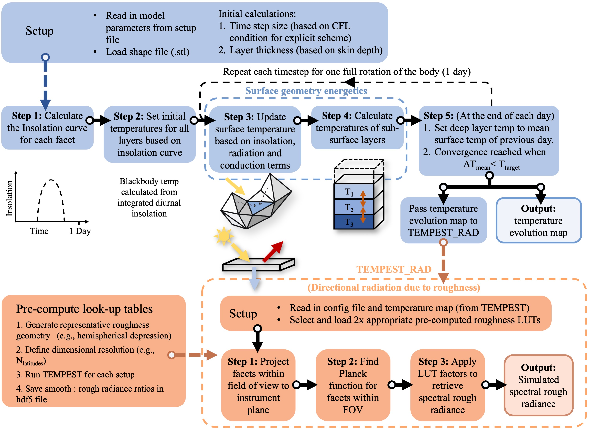

# TEMPEST v2.0.0 - Thermophysical Body Model
This Python script simulates diurnal temperature variations of a solar system body based on a given shape model. Initially designed for ESAs Comet Interceptor Mission planning as part of my research at the University of Oxford, it's adaptable for asteroids and other planetary bodies like Enceladus' surface fractures. As of 25 June 2026 it is stable and a range of test shape models converge well, but it is still under development to improve ease of use, computation speed, and validity in a wider range of parameter spaces. 

V2 brings roughness capability into TEMPEST for the first time with the TEMPEST_RAD module and is accompanied by a paper submitted to MNRAS on 23 June 2026. I will update this repo over the next couple of weeks to include all correct documentation and a reference to the paper pre-print which explains the roughness scheme in detail. 

## Features
- Simulates temperature variations considering material and model properties.
- Calculates insolation and temperature arrays for each model facet, iterating until model convergence.
- Visualises results and saves for further analysis.
- SI units are standard, exceptions are clearly stated.

## How to Get Started
You can watch this (slightly outdated but still useful) video which takes you through from download to running TEMPEST v1 on your own computer: https://youtu.be/0_YJEAbp2vQ

1. Download this repository as a .zip file by clicking on the V2.0.0 "Tagged Release". Download and expand the .zip. 
2. Open a terminal window and navigate to the TEMPEST folder you have downloaded (this may trigger a package update that could take a few minutes)
3. Ensure you have Python 3.x installed and selected (you can download at https://www.python.org/ then check this using `python --version`) 
4. Ensure all dependencies are installed `pip install -r requirements.txt`
5. Run the script with Python: `python tempest.py --config data/config/example_config.yaml`

TEMPEST will then:
1. Calculate insolation and temperature arrays.
2. Iterate through the model until convergence is reached.
3. Visualise results with the option of saving them for further analysis.

To adapt the model to your own purposes start by updating settings including material, model parameters and shape model selection in data/config/example_config.yaml

Tips:
Use and Integrated Development Environment (IDE) for example VS Code (download at https://code.visualstudio.com/) for editing your config.yaml file, and to inspect/edit any of the source code. 
If your shape model is not in ASCII .stl format, you can use Blender (download at https://www.blender.org/) to convert it.

## Model Architecture
See below flowchart from the TEMPEST paper (preprint) which gives more detail on the model architecture. 

## Contribution
Feel free to fork the project for custom enhancements or issue tracking on GitHub! 

## Get involved!
Use this form to report bugs, request new features, or share general feedback about TEMPEST: https://forms.gle/5URtNJFHyysvVmtWA

Follow this link to join the TEMPEST mailing list and be notified (occasionally and tastefully) of updates, news, and publications: https://forms.gle/MG8RKgb6ETR35wBi7

## Author and Acknowledgements
Duncan Lyster | Started: 15 Feb 2024
With contributions from: Joe Penn, Maisie Rashman, and Bea Chikani

## Citation and Attribution

If you use TEMPEST in any academic publication, presentation, or public derivative work, please cite:

> Lyster, D.G. and Howett, C.J., (2026).
> *TEMPEST-A modular Python-based thermophysical model for rough, irregularly-shaped airless bodies.*
> RAS Techniques and Instruments, p.rzag093.

Please also include the TEMPEST version number used, as well as the copyright notice and license file in any redistributed form.

## Licence

This project is open-source under a modified MIT License that requires attribution in academic and public use.  
See the [LICENSE](LICENSE) file for full terms.

## Papers Using Tempest 
(Please get in touch if you have a paper that uses TEMPEST that isn't already on this list!) 

- Lyster, D.G. and Howett, C.J.A. (2026). TEMPEST - A modular Python-based thermophysical model for rough, irregularly-shaped airless bodies. *RAS Techniques and Instruments*, rzag093. [doi:10.1093/rasti/rzag093](https://doi.org/10.1093/rasti/rzag093)

- Howes, S.E., Howett, C.J.A., Lyster, D.G., Lange, L. and Piqueux, S. (2026). Thermal inertia and bolometric Bond albedo measurements of Europa's surface using Galileo PPR. *Monthly Notices of the Royal Astronomical Society*, 551(2), stag1507. [doi:10.1093/mnras/stag1507](https://doi.org/10.1093/mnras/stag1507)

- Jasmonts, G., Šķirmante, K., Blumbergs, K., Palos, M.F., Arshad, A. and Slavinskis, A. (2026). A physics-informed framework for synthetic flyby imaging of activity in dynamically new comets. *Monthly Notices of the Royal Astronomical Society*, 551(4), stag1556. [doi:10.1093/mnras/stag1556](https://doi.org/10.1093/mnras/stag1556)

- Braga, L., Amarante, A., Ferreira, A., Monteiro, F. and Martins, M. (2026). Surface properties, orbital dynamics, and thermophysical modeling of the primitive asteroid (269) Justitia. *The Planetary Science Journal*, 7(2), 46. [doi:10.3847/PSJ/ae3d93](https://doi.org/10.3847/PSJ/ae3d93)

- Gomes, C., Amarante, A., Monteiro, F., Ferreira, A., Braga, L., de Almeida Jr., A.K., Lyster, D., Rocha, N., Damilano, G. and Barbosa, L. (2026). Dynamical behavior and surface features of large super-fast rotator near-Earth asteroid (436724) 2011 UW158. *Icarus*, 462, 117340. [doi:10.1016/j.icarus.2026.117340](https://doi.org/10.1016/j.icarus.2026.117340)
